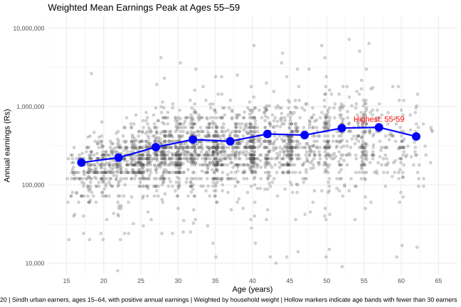
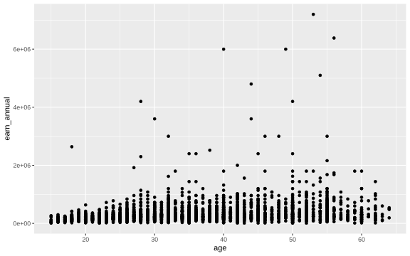
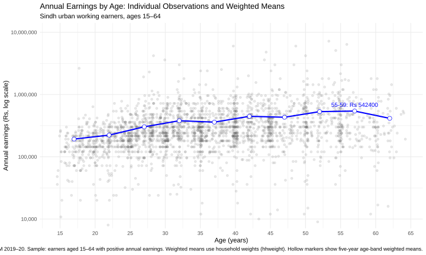

/##Variant 3 — Sindh Urban

## Question 2: Weighted Earnings Histogram

| Statistic | Result |
|---|---:|
| Original observations | 6,687 |
| Valid earners | 2,644 |
| Excluded observations before final sample | 4,043 |
| Unweighted median annual earnings | Rs 252,000 |
| Weighted 10th percentile (P10) | Rs 120,000 |
| Weighted median (P50) | Rs 264,000 |
| Weighted 90th percentile (P90) | Rs 696,000 |
| P90/P10 ratio | 5.80 |
| Earners excluded from histogram range | 2 |

### Interpretation

The weighted median annual earnings of urban earners in Sindh are Rs 264,000, compared with the unweighted median of Rs 252,000. The weighted 10th and 90th percentiles are Rs 120,000 and Rs 696,000, respectively. The P90/P10 ratio of 5.80 indicates a substantial earnings gap between lower- and higher-earning workers. Of the 6,687 original observations, 4,043 did not meet the sample selection criteria, leaving 2,644 valid earners. Of these, two fell outside the histogram's specified earnings range of Rs 10,000 to Rs 10,000,000.

## Question 3: The Relationship Between Age and Earnings

### Figure

**Figure 2: Annual Earnings by Age in Urban Sindh**

**Figure file:** `figures/q3_age_earnings.svg`

The figure presents individual annual earnings by age, along with weighted mean earnings for each five-year age band. The vertical axis uses a logarithmic scale and is labelled in Pakistani rupees. Individual observations are shown as semi-transparent, horizontally jittered points, while larger markers connected by a line represent weighted mean earnings at each age-band midpoint. Hollow markers indicate age bands with fewer than 30 earners.

### Age-Band Statistics

| Age band (years) | Number of earners | Weighted mean earnings (Rs) |
|:---|---:|---:|
| 15–19 | 160 | 192,523 |
| 20–24 | 296 | 222,948 |
| 25–29 | 398 | 303,154 |
| 30–34 | 396 | 379,254 |
| 35–39 | 359 | 360,221 |
| 40–44 | 344 | 446,533 |
| 45–49 | 250 | 431,697 |
| 50–54 | 212 | 530,773 |
| 55–59 | 157 | 542,400 |
| 60–64 | 72 | 414,262 |

### Required Results

- **Weighted mean earnings for ages 25–29:** Rs 303,154.
- **Weighted mean earnings for ages 45–49:** Rs 431,697.
- **Age band with the highest weighted mean earnings:** Ages 55–59, at Rs 542,400.

### Interpretation

Weighted mean earnings generally increase across age bands, rising from Rs 192,523 for earners aged 15–19 to a peak of Rs 542,400 for those aged 55–59. However, the pattern is not consistently upward: mean earnings decline among ages 35–39 and 45–49, before falling to Rs 414,262 for ages 60–64. The mean for ages 45–49 is Rs 431,697, compared with Rs 303,154 for ages 25–29. From an economic perspective, these differences may reflect experience, occupation, or other factors. However, this cross-sectional figure cannot establish that an individual's earnings rise as they age or prove that age causes higher earnings.

## Question 4: Default Graph and Redesign

### Default Graph

The default graph was created using `ggplot(data, aes(x = age, y = earn_annual)) + geom_point()`. It displays individual observations using the default plotting settings without additional styling or transformations.

**Figure:** `figures/default.svg`

### Redesigned Graph

The redesigned graph improves readability by making individual observations semi-transparent and adding horizontal jitter to reduce overlapping points. Weighted mean annual earnings are calculated for five-year age bands and displayed using a connected line and hollow markers. The y-axis uses a logarithmic scale to show the wide variation in earnings, and the highest-earning age band is annotated.

**Figure:** `figures/redesign.svg`

### Design Changes and Principles

1. **Transparency:** Reduces visual clutter caused by overlapping observations.
2. **Horizontal jitter:** Makes individual observations easier to distinguish without materially changing their age positions.
3. **Weighted means and connecting line:** Highlights the overall earnings pattern across age bands.
4. **Logarithmic y-axis:** Makes the wide range of annual earnings easier to examine.
5. **Annotation:** Draws attention to the age band with the highest weighted mean earnings.
   
##Default vs Redesign

| Default Graph | Redesigned Graph |
|---|---|
|  |  |
### What the Default Graph Shows

The default graph preserves the raw observations and makes their overall spread visible. However, overlapping points and the wide earnings range make the age-related pattern harder to interpret than in the redesigned graph.

##question 5

## Second-Language Replication: Python

The Q3 age-band analysis was replicated in Python using the PSLM 2019–20 person and household datasets. The sample was restricted to urban Sindh earners aged 15–64 with positive annual earnings. Household weights (`hhweight`) were used to calculate weighted mean annual earnings for each five-year age band.

The Python results matched the R results to the rupee.

**25–29 age band weighted mean earnings:**
- R: Rs 303,154
- Python: Rs 303,154

**Figure:** `figures/q3_python.svg`

**Script:** `scripts/q3_python.py`

Both implementations use the same sample restrictions, age bands, and household weights.

